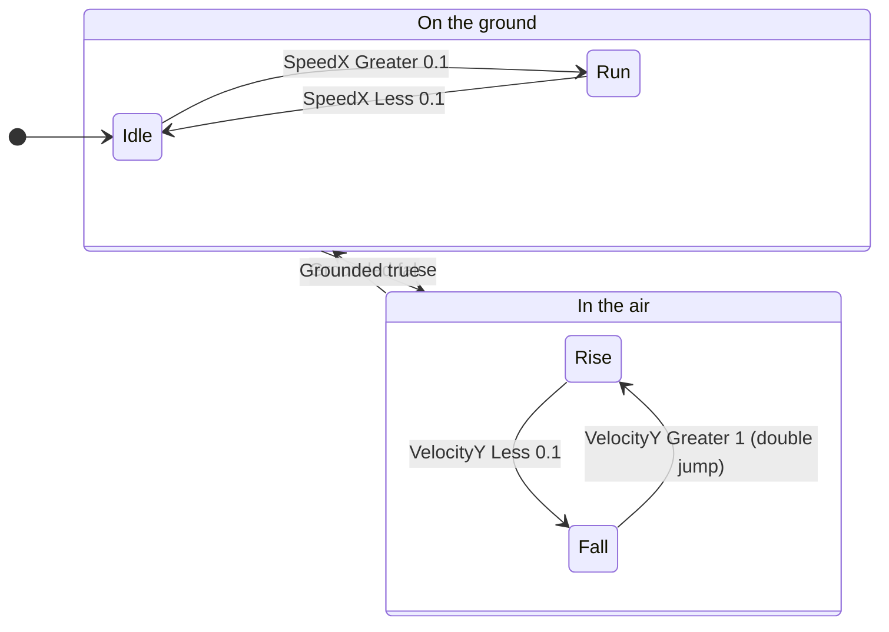
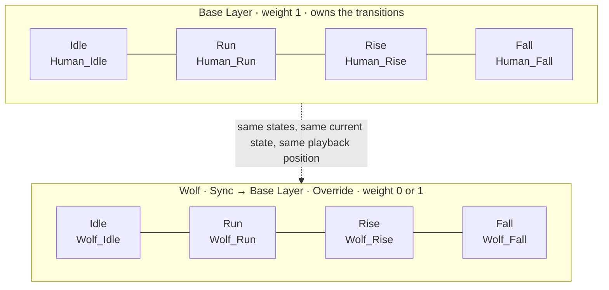

# Animating the Werewolf

A walkthrough of Unity's Animator for Lobojuego: sprite import, clips, one state machine shared by the human and the wolf, how to drive it from `PlayerMovement`, and the pitfalls that catch almost everyone.

> Written in November 2026 against the code at that time. Sections that mention specific fields or properties (`velocity`, `lastMoveResults`, `isHuman`) describe the code as it was then.

## What you'll end up with

- Four states: **Idle**, **Run**, **Rise**, **Fall**. The transitions are written once.
- A **Base Layer** holding the human clips, and a **Wolf** layer synced to it, holding the wolf clips.
- Shapeshifting sets the Wolf layer's weight to 1 or 0. The state and its animation progress carry over, so a mid-air switch doesn't hitch.
- A `PlayerAnimator` component that only reads gameplay state and passes it to the Animator. Movement code never refers to animation.

## Contents

1. [Split visuals from physics](#1-split-visuals-from-physics)
2. [Import the sprites](#2-import-the-sprites)
3. [Make the clips](#3-make-the-clips)
4. [Build the state machine](#4-build-the-state-machine)
5. [Feed it from code](#5-feed-it-from-code)
6. [Two forms, one state machine](#6-two-forms-one-state-machine)
7. [States only one form has](#7-states-only-one-form-has)
8. [Pitfalls](#pitfalls)
9. [Debugging](#debugging)

---

## 1. Split visuals from physics

Put the sprite on a child object. The root keeps everything physical, and the child holds everything that draws.

```
Player            Rigidbody2D, BoxCollider2D, KinematicMover,
                  PlayerMovement, Shapeshifter, PlayerAnimator
└─ Visual         SpriteRenderer, Animator
```

Reasons:

- **Flipping and offsets stay cosmetic.** You can flip or nudge the sprite without touching the collider the mover casts.
- **Clips can't move the body.** A clip only animates objects under its Animator. With the Animator on `Visual`, a stray keyframe can never move the Rigidbody, which keeps the rule that all motion goes through the mover.
- **Clip bindings stay short.** Clips store property paths relative to the Animator's object. On `Visual`, the sprite path is empty, so nothing breaks if you rename objects above it.

If the `SpriteRenderer` is on the Player root today, create the child, add a new SpriteRenderer there, and remove the old one.

## 2. Import the sprites

Most "my animation looks wrong" problems come from import settings, not the Animator. Set these on every sprite sheet, for both forms:

| Setting | Value | Why |
|---|---|---|
| Texture Type | Sprite (2D and UI) | |
| Sprite Mode | Multiple | One texture holds many frames. |
| Pixels Per Unit | One value for the whole game | The same PPU on the human, the wolf and the tiles keeps their pixels the same size. Mismatched PPU makes the wolf look scaled. |
| Filter Mode | Point (no filter) | Bilinear blurs pixel art. |
| Compression | None | Compression smears colors in small sprites. |
| Generate Mip Maps | Off | Not needed for 2D, and causes shimmer. |

Then open the **Sprite Editor** and slice: *Slice → Grid By Cell Size*, with your frame size. Set every frame's **pivot to the same point on the feet**, usually Bottom Center, or a Custom pivot if the drawing isn't centered in its cell.

```
   Pivot at the feet                  Pivot at the center

    ┌──┐                               ┌──┐
    │  │                               │  │      ┌────────┐
    │H │    ┌────────┐                 │H•│      │   W•   │
    │  │    │   W    │                 │  │      └────────┘
    └•─┘    └───•────┘                 └──┘        ↕ floats
  ═══════════════════════            ═══════════════════════

  • = pivot.  Both forms stand        The wolf is shorter, so a center
  on the ground after switching.      pivot leaves it hanging in the air.
```

The Visual object sits at the same spot in both forms, so the pivot decides where the drawing lands. A foot pivot keeps both forms on the ground through a shapeshift. Any other pivot makes one form float or sink.

### If you draw in Aseprite

The project already has the `com.unity.2d.aseprite` package, so `.aseprite` files import directly. Each **tag** becomes an animation clip, frame durations carry over, and saving the file in Aseprite updates the clips in Unity. The importer also sets PPU, filter and pivot. Set the pivot in its inspector so both forms match.

The importer can also generate an Animator Controller, but that one is part of the imported asset. Build your own controller (step 4) and use the imported clips in it.

## 3. Make the clips

Skip this step if Aseprite makes your clips. Otherwise, you need eight clips: `Human_Idle`, `Human_Run`, `Human_Rise`, `Human_Fall`, and the same four for `Wolf_`.

1. Select `Visual`, then open *Window → Animation → Animation* (`Ctrl+6`).
2. Click **Create** and save the clip as `Human_Idle.anim`. The first time, Unity also creates an Animator Controller and adds an Animator to `Visual`. Keep the controller and rename it, for example to `Player.controller`.
3. Open the window's **⋮** menu and enable *Show Sample Rate*. Set the rate *before* adding sprites. Pixel-art cycles usually run at 8–12 samples per second.
4. Drag the sliced frames from the Project window onto the timeline. Each one becomes a key on the `SpriteRenderer.Sprite` property, spaced one sample apart.
5. Make the other clips from the clip dropdown at the top-left of the window, using *Create New Clip…*
6. Select each `.anim` in the Project window and set **Loop Time**: on for Idle and Run, and on for Rise and Fall if they cycle, such as a flapping cape. Turn it off for one-shot poses that should hold their last frame.

> **Match the run to the run speed.** If the feet appear to slide over the ground, the run cycle's stride doesn't match the movement speed. The wolf will have its own max speed, so each form's run cycle needs its own stride. You can also scale the Run state's playback with its Speed *Multiplier* parameter (step 4), driven by how fast the character is moving, so it plays slower while accelerating.

## 4. Build the state machine

Open `Player.controller` (*Window → Animation → Animator*). Three concepts matter:

- **States** play a motion, usually a clip. The orange state is the default, where the Animator starts.
- **Parameters** are values your code writes: Float, Int, Bool, or Trigger. A Trigger is a Bool that resets itself once a transition uses it.
- **Transitions** are arrows between states with conditions on parameters. The Animator checks the current state's outgoing transitions every frame and takes the first one whose conditions are all true, in the order they appear in the transition list.

### Why Rise and Fall instead of a single Jump state

The character is airborne in situations that start without a jump: walking off a ledge, and later, the end of the dash. And a jump has two phases: going up, and coming down. If the Animator tracks *whether the character is grounded and which way it's moving vertically* instead of *whether jump was pressed*, every way of leaving the ground plays the right animation. The double jump falls out of the same logic: vertical speed turns positive again, so Fall goes back to Rise.

### Parameters

| Name | Type | Value |
|---|---|---|
| `SpeedX` | Float | Absolute horizontal speed. Use the distance actually moved, not the requested velocity (see step 5). |
| `VelocityY` | Float | Vertical speed. Positive means going up. |
| `Grounded` | Bool | Whether the last move hit floor. |

### States and transitions



The arrows between the two groups each stand for several real transitions:

| From | To | Conditions (all must be true) |
|---|---|---|
| Idle | Run | `SpeedX Greater 0.1` |
| Run | Idle | `SpeedX Less 0.1` |
| Idle, Run | Rise | `Grounded false`, `VelocityY Greater 0.1` · *first in the list* |
| Idle, Run | Fall | `Grounded false` · *second, as a fallback* |
| Rise | Fall | `VelocityY Less 0.1` |
| Fall | Rise | `VelocityY Greater 1` |
| Rise, Fall | Idle | `Grounded true`, `SpeedX Less 0.1` |
| Rise, Fall | Run | `Grounded true`, `SpeedX Greater 0.1` |

Two details in this table are deliberate:

- **Thresholds, not zero.** Floats rarely land exactly on 0, and the Animator only has *Greater* and *Less*, so `Greater 0` and `Less 0` together leave a gap at exactly 0 where neither is true.
- **Different thresholds in each direction** (Rise→Fall below 0.1, Fall→Rise above 1). The gap between them stops the two states from flickering back and forth when the speed hovers near one threshold. This is called hysteresis.

### Transition settings for sprite animation

Select each transition and set the following. New transitions start with defaults meant for blending 3D animations:

| Setting | Default | Set to | Why |
|---|---|---|---|
| Has Exit Time | On | **Off** | When on, the transition waits until the current clip reaches a point in its playback, so jumping can wait for the idle cycle to finish. The animation should respond immediately. |
| Transition Duration | 0.25 | **0** | Sprites can't blend. During a non-zero blend, the sprite stays on the old state's frame, so every change looks delayed. |

Keep Has Exit Time on only for transitions that really should wait for a clip to finish, such as leaving a one-shot animation (step 7).

### About Any State and sub-state machines

**Any State** transitions are checked from every state. They save arrows, but by default an Any State transition can also go to the state you're already in. "Any State → Fall when not grounded" would restart Fall every frame, freezing it on frame 1. If you use Any State, turn off *Can Transition To Self* on that transition.

**Sub-state machines** only group states visually. With four states, a flat layout is easier to debug.

## 5. Feed it from code

Following the principle that gameplay and its consumers stay separate: `PlayerMovement` and `Shapeshifter` get read-only properties, and a new component turns them into Animator parameters. The Animator never decides gameplay.

### Expose state on the gameplay components

```csharp
// PlayerMovement.cs
public Vector2 MovedVelocity => lastMoveResults.appliedOffset / Time.fixedDeltaTime;
public bool IsGrounded => lastMoveResults.Grounded;

// Shapeshifter.cs
public bool IsHuman => isHuman;
```

`MovedVelocity` uses the distance the mover actually applied instead of `velocity`. When this was written, `velocity.x` stayed at full speed while pushing into a wall, because only the vertical component was zeroed after a collision. Feeding the requested velocity to the Animator would play the run cycle against the wall.

### The PlayerAnimator component

```csharp
using UnityEngine;

public class PlayerAnimator : MonoBehaviour
{
    [SerializeField] Animator animator;
    [SerializeField] SpriteRenderer spriteRenderer;
    [SerializeField] PlayerMovement movement;
    [SerializeField] Shapeshifter shapeshifter;

    // Hashear los nombres una sola vez: es más rápido y evita errores de tipeo
    static readonly int SpeedX = Animator.StringToHash("SpeedX");
    static readonly int VelocityY = Animator.StringToHash("VelocityY");
    static readonly int Grounded = Animator.StringToHash("Grounded");
    int wolfLayer;

    void Awake()
    {
        wolfLayer = animator.GetLayerIndex("Wolf");
    }

    void Update()
    {
        Vector2 v = movement.MovedVelocity;
        animator.SetFloat(SpeedX, Mathf.Abs(v.x));
        animator.SetFloat(VelocityY, v.y);
        animator.SetBool(Grounded, movement.IsGrounded);

        // Con peso 1, el layer del lobo tapa por completo al humano
        animator.SetLayerWeight(wolfLayer, shapeshifter.IsHuman ? 0 : 1);

        // Mirar hacia donde se mueve; si está quieto, mantener la dirección
        if (Mathf.Abs(v.x) > 0.01f)
            spriteRenderer.flipX = v.x < 0;
    }
}
```

Notes on this component:

- **Why `Update`.** Gameplay runs in `FixedUpdate` and the Animator (in its default *Normal* update mode) runs once per rendered frame. Reading in `Update` sends the newest simulated values to every frame that gets drawn.
- **Assign the references in the Inspector.** Put `PlayerAnimator` on the Player root and drag in `Visual`'s Animator and SpriteRenderer.
- **Facing is temporary here.** The forward dash needs to know which way the player faces, so facing will become gameplay state. When that happens, move it into `PlayerMovement` and have this component only read it.
- **`flipX` mirrors around the pivot.** That's another reason for a centered foot pivot: an off-center pivot makes the sprite jump sideways when it turns.

## 6. Two forms, one state machine

You want one set of transition rules and two sets of clips. There are three ways to set that up. For this game, synced layers are the best fit, because the switch happens mid-motion and has to be seamless.



The Wolf layer has no transitions of its own. It mirrors the Base Layer's current state and only supplies a different clip for each one.

### Setting up the synced layer

1. In the Animator window, open the **Layers** tab and click **+**. Name the layer `Wolf`.
2. Click its gear icon. Set **Weight** to 0, **Blending** to Override, enable **Sync**, and choose *Base Layer* as the source.
3. Enable **Timing** as well. Without it, a wolf clip plays over the human clip's duration, so a 6-frame wolf run is stretched to fit an 8-frame human run. With Timing on and the layer at full weight, each wolf clip keeps its own length.
4. With the Wolf layer selected, click each state and set its **Motion** to the matching `Wolf_` clip.

When the form changes, `PlayerAnimator` sets the layer weight to 0 or 1, and the sprite swaps on the next frame. The state machine keeps going: if you shapeshift halfway through a fall, you're still in Fall at the same point in the animation, now drawn as the other form. If you shapeshift while running, the run cycle continues from the same stride phase.

### How the three approaches compare

| | Synced layer | Override controllers | States duplicated per form |
|---|---|---|---|
| Transitions written once | Yes | Yes | No: every rule exists twice |
| Switching keeps the state and playback position | Yes, automatically | No: needs code (below) | Only with extra transitions |
| States only one form has | Allowed if gated (step 7) | Allowed if gated (step 7) | Natural |
| Best for | One character with several looks that switch mid-action | Many characters that share one rig of rules | Forms whose rules differ a lot |

### The alternative: Animator Override Controllers

An **Animator Override Controller** is an asset that points to a base controller and swaps its clips one by one. You would make `Wolf.overrideController` and switch `animator.runtimeAnimatorController` when shapeshifting. This works well for enemy variants, where the swap happens at spawn.

The catch for a mid-air switch: **assigning a new controller resets the Animator.** It goes back to the default state, and every parameter returns to its default value. Without extra code, a wolf that turns human while falling shows one frame of Idle. If you ever need this approach, preserve the state yourself:

```csharp
var state = animator.GetCurrentAnimatorStateInfo(0);
animator.runtimeAnimatorController = isHuman ? humanController : wolfController;
// Acá hay que volver a cargar todos los parámetros (SetFloat, SetBool...)
animator.Play(state.fullPathHash, 0, state.normalizedTime);
animator.Update(0f); // aplicar ya, no en el próximo frame
```

## 7. States only one form has

Synced layers mirror the Base Layer's states, so a state for one form still has to exist in the Base Layer. The rule is: **every state exists for both forms, but a form-specific state can only be entered while in that form.** Its slot in the other form's layer is simply never seen.

The two planned abilities are good examples:

### Wolf only: Dash

- Add a `Dash` state to the Base Layer. Its Base Layer motion can stay empty. In the Wolf layer, assign `Wolf_Dash`.
- **Gameplay owns the timing.** The dash lasts as long as `PlayerMovement` says, not as long as the clip. So drive it with a Bool `IsDashing` that gameplay sets: Any State → Dash when `IsDashing true` (with *Can Transition To Self* off), and Dash → Fall when `IsDashing false`. If the clip finishes first, it loops or holds its last frame. Nothing changes the dash's actual duration.
- The dash only happens in wolf form, so `IsDashing` already implies the wolf. For a wolf-only state that shared input could trigger, such as a crouch, add an `IsWolf` Bool and include it in the entry condition.

### Human only: a double-jump flip

- Rise already covers the double jump. A dedicated flip animation is optional.
- If you add one, it's purely cosmetic, so a **Trigger** fits: `DoubleJump`, set once by the ability code. Use Any State → Flip on the trigger, and Flip → Rise or Fall with **Has Exit Time on**. This is one of the cases where waiting for the clip to end is right.

> **The failure to watch for:** if the wolf ever shows a human frame, or the default sprite, a Wolf-layer state is missing its Motion. That usually happens after adding a state to the Base Layer: the new state appears in the synced layer with no clip, and nothing warns you.

An instant swap can still look abrupt even when it's technically seamless. A common trick is a short burst sprite, such as smoke or claw marks, spawned on a separate object at the moment of the switch. It covers the frame where the silhouette changes without adding states to the controller.

---

## Pitfalls

### Import

- **Blurry or smudged pixels.** Filter Mode isn't Point, or compression is on. *Fix:* change both on the texture, and consider URP's *Pixel Perfect Camera* so pixels stay on the screen grid.
- **Thin lines at the edge of frames.** Neighboring frames on the sheet bleed into each other. *Fix:* leave a few pixels of padding between frames on the sheet, or slice with an offset/padding.
- **One form looks bigger or smaller than intended.** Different Pixels Per Unit on the two sheets. *Fix:* use one PPU for the whole game.
- **Feet pop up or down on shapeshift or turn.** Pivots differ between frames or forms. *Fix:* use one foot pivot convention everywhere (step 2).

### Clips

- **Animation plays absurdly fast.** Sprites were dropped onto the timeline at the default 60 samples per second, so each frame lasts 1/60 s. *Fix:* set the sample rate before adding sprites, or select all keys and drag to rescale them.
- **Last frame of a loop flashes by.** The clip ends exactly on the last key, so that frame gets little or no screen time. *Fix:* if it looks short, add a duplicate key one sample later.
- **Jump pose loops when it should hold.** *Fix:* turn off *Loop Time* on the clip asset.
- **Clip shows yellow "(Missing!)" properties.** Bindings are stored as paths from the Animator. A renamed or moved child breaks them. *Fix:* keep the Animator on the object that has the SpriteRenderer, or rename back.
- **The character snaps to a fixed position.** Record mode (the red button) keyed Transform Position while you dragged something. The clip then overwrites the position every frame. *Fix:* delete that property from the clip. Leave record mode off unless you're keying on purpose.

### Transitions

- **Animation lags behind input.** Has Exit Time is on, or Transition Duration is above 0. *Fix:* change both on every new transition (step 4).
- **Stuck on the first frame of a state.** An Any State transition keeps re-entering the state. *Fix:* turn off *Can Transition To Self*.
- **The wrong transition fires.** Several transitions are valid at once and the first in the list wins. *Fix:* reorder them in the state's Inspector list, or make their conditions mutually exclusive.
- **Rapid flicker between two states.** A value hovers around a threshold, or the conditions overlap. *Fix:* use different thresholds for each direction (step 4).
- **Stuck in a state.** There is a value no outgoing transition covers, such as exactly 0 with only `Greater 0` and `Less 0`. *Fix:* check that the conditions together cover every value.

### Parameters and code

- **A parameter "does nothing".** Its name is misspelled. `SetFloat("speedX")` only logs a warning. *Fix:* use hashed names stored in static fields, one place to get them right.
- **An animation fires long after its trigger.** Triggers stay set until a transition uses them. A trigger set when no transition could react fires later, in some unrelated situation. *Fix:* use Bools for anything that describes a state, keep Triggers for one-shot moments, and call `ResetTrigger` when a pending trigger should be cancelled.
- **Animator resets when the object is re-enabled.** Disabling an Animator's GameObject discards its state by default. *Fix:* set `animator.keepAnimatorStateOnDisable = true` if you need to hide the player temporarily.
- **Run cycle plays against a wall.** The requested velocity was sent to the Animator instead of the actual movement. *Fix:* use `MovedVelocity` (step 5).
- **Brief Fall frames while walking.** `Grounded` comes from each physics step's collisions. Going down a slope faster than gravity pulls, or crossing a ledge lip, can produce one step without floor contact. *Fix:* report "airborne" to the Animator only after a short grace time (around 0.05–0.1 s) or once falling speed passes a threshold. The same buffer will later serve coyote time.
- **Gameplay waits for animations.** Gameplay logic reads Animator state or uses animation events to decide when things end. *Fix:* keep the timing in gameplay code, and use animation events only for cosmetic effects such as footstep sounds and dust.

### Editor

- **Changes made during Play stick.** Scene changes are reverted when Play mode ends, but asset changes are not, and controllers and clips are assets. This is handy for tuning. Just don't expect a reset when you stop Play.
- **Motion stutters even though the animation is correct.** Physics runs 50 times a second. With Interpolate off on the Rigidbody2D, the character only moves on physics steps, which shows on fast monitors. *Fix:* this is movement, not animation. Set the Rigidbody2D's Interpolate to Interpolate.

## Debugging

- **Watch the live state machine.** Enter Play mode, select `Visual`, and open the Animator window. The current state shows a progress bar, and the transition being taken is highlighted.
- **Drive parameters by hand.** During Play, the Parameters panel is editable. Disable `PlayerAnimator` and toggle `Grounded` or drag `VelocityY` to test transitions without playing the level.
- **Check each layer.** Switch to the Wolf layer in the Animator window to confirm it mirrors the base state and has a clip on every state.
- **Preview clips alone.** In the Animation window, select a clip and press its play button to check timing and loop seams without running the game.
- **Slow everything down.** Setting `Time.timeScale = 0.2f` from a debug key makes single-frame flickers visible.
